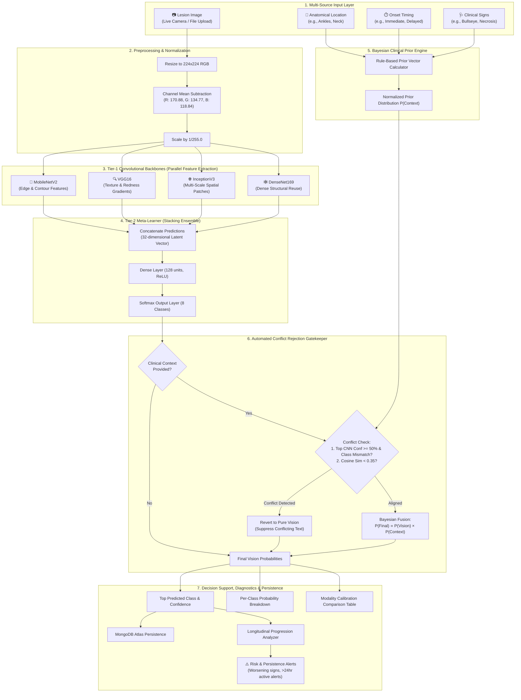

# 🦟 ResQ_Ai: Multimodal Insect Bite & Skin Reaction Classification System

[](https://www.python.org/downloads/)
[](https://tensorflow.org/)
[](https://streamlit.io/)
[](https://www.mongodb.com/atlas)

A clinical-grade deep learning and expert-guided decision support system designed to classify insect bites and dermatological reactions into **8 canonical classes** using a **Two-Tier Stacking Ensemble (MobileNetV2, VGG16, InceptionV3, DenseNet169)** fused with **clinical prior evidence**, **conflict rejection gatekeeping**, and **longitudinal progression tracking**.

---

## 📌 Key Highlights & Features

- **Two-Tier Stacking Ensemble:** Aggregates multi-scale spatial representations and complementary feature spaces from 4 deep convolutional backbones: **MobileNetV2**, **VGG16**, **InceptionV3**, and **DenseNet169**.
- **Specialized Meta-Learner:** A dense meta-classifier trained on the concatenated outputs (32 latent features) of all backbones to resolve model disagreements and maximize classification accuracy.
- **Empirical Channel Normalization:** Preprocessed using exact dataset per-channel mean subtraction ($R=170.88, G=134.77, B=118.84$).
- **Dual-Mode Inference:** Supports both **Pure Vision Inference** (image-only) and **Multimodal Bayesian Context Fusion** (image + clinical context).
- **Automated Conflict Rejection Gatekeeper:** Automatically detects and suppresses conflicting symptom/location text if deep visual feature confidence or cosine similarity contradicts patient input.
- **Longitudinal Progression & Risk Tracking:** Persists diagnostic sessions to MongoDB Atlas to analyze bite evolution over time and trigger persistence/worsening risk alerts (e.g., Lyme disease risks, necrosis monitoring).

---

## 🔄 End-to-End System Workflow

The following architecture diagram illustrates how an image and optional clinical priors flow through the ResQ_Ai classification and decision-support pipeline:



### Detailed Workflow Stages

1. **Input Acquisition**:
   - **Visual Stream:** User captures or uploads a macro skin lesion photograph.
   - **Clinical Metadata Stream:** User/clinician specifies bite body area, symptom onset timing, and hallmark physical signs (e.g., target bullseye rash, fang punctures, central pustules).
2. **Standardized Preprocessing**:
   - Resizes input image to standard $224 \times 224$ pixels.
   - Applies dataset-specific channel-wise mean subtraction followed by unit normalization to preserve fine lesion pigmentation differences.
3. **Tier-1 Parallel Ensemble Inference**:
   - The preprocessed tensor is concurrently fed into 4 diverse, pre-trained convolutional backbones (MobileNetV2, VGG16, InceptionV3, DenseNet169).
   - Each network independently outputs an 8-class probability distribution based on its unique inductive bias and receptive field.
4. **Tier-2 Stacking Meta-Learner Arbitrage**:
   - The four 8-dimensional output vectors are concatenated into a 32-dimensional latent feature vector.
   - The meta-learner (`Dense(128) -> Dense(8, softmax)`) processes these representations to resolve inter-model ambiguities and output the calibrated visual probability distribution $P(\text{Vision})$.
5. **Bayesian Clinical Fusion**:
   - When clinical metadata is provided, the system computes a prior probability distribution $P(\text{Context})$ based on epidemiological, spatial, and symptomatic diagnostic rules.
6. **Conflict Rejection Gatekeeping**:
   - The gatekeeper evaluates the consistency between $P(\text{Vision})$ and $P(\text{Context})$ using **Cosine Similarity** and **Confidence Thresholding**.
   - If the visual evidence is strong and contradicts the text, or if similarity falls below 0.35, the system safely suppresses the prior and falls back to pure vision. Otherwise, it executes Bayesian element-wise multiplication and re-normalization.
7. **Longitudinal Tracking & Decision Support**:
   - Outputs the final classification, percentage confidence, and per-class breakdown.
   - Persists the record with a UTC timestamp to MongoDB Atlas.
   - Queries previous patient scans at the same body site to detect worsening symptoms (e.g., emerging necrosis, spreading ring) or prolonged lesion duration (>24 hours).

---

## 🧠 Model Architecture & Roles in the Ensemble

The system avoids reliance on a single architecture by utilizing a **Two-Tier Stacking Ensemble**. Different CNN architectures specialize in distinct visual feature domains:

```
Input Image (224x224x3)
│
├──► [Backbone 1] MobileNetV2  ──► (8 logits) ──┐
├──► [Backbone 2] VGG16        ──► (8 logits) ──┼──► Concatenate (32) ──► Dense(128) ──► Softmax (8 Classes)
├──► [Backbone 3] InceptionV3  ──► (8 logits) ──┤
└──► [Backbone 4] DenseNet169  ──► (8 logits) ──┘
```

### 1. 📱 MobileNetV2 (Lightweight Edge & Contour Specialist)
- **Role:** High-speed, depthwise separable convolutional feature extraction.
- **Specialization:** Captures micro-lesions, sharp localized boundary contours, fine edge definitions, and peripheral bite margins with minimal computational overhead.
- **Parameters:** ~5.22M parameters.

### 2. 🔍 VGG16 (Texture & Erythema Gradient Specialist)
- **Role:** Deep uniform $3 \times 3$ convolutional feature extractor.
- **Specialization:** Highly sensitive to low-level color textures, surrounding erythematous flush (skin redness intensity), subtle skin pigmentation shifts, and diffuse flare reactions.
- **Parameters:** ~27.69M parameters.

### 3. 🌐 InceptionV3 (Multi-Scale Spatial Pattern Specialist)
- **Role:** Multi-branch factorized inception modules.
- **Specialization:** Processes multi-scale visual features simultaneously. Crucial for recognizing lesions of drastically varying scales, such as large expanding erythema migrans (Lyme disease bullseye rings) alongside small pinpoint flea clusters.
- **Parameters:** ~116.70M parameters.

### 4. 🕸️ DenseNet169 (Dense Feature Reuse & Structural Specialist)
- **Role:** Deep densely connected convolutional network connecting all layers directly.
- **Specialization:** Mitigates vanishing gradients and maximizes feature reuse. Excels at identifying complex central lesion structures such as necrotic centers, double fang puncta, central blisters, and ulcerations.
- **Parameters:** ~17.18M parameters.

### 5. 🎯 Tier-2 Stacking Meta-Learner (Decision Arbiter)
- **Role:** Higher-level neural aggregator and error-corrector.
- **Architecture:** `Input(32) -> Dense(128, activation='relu') -> Dense(8, activation='softmax')`.
- **Specialization:** Rather than relying on simple majority voting or arithmetic averaging, the meta-learner learns non-linear correlations and reliability weights among the 4 backbones, drastically reducing false positives and outperforming any standalone model.

### 6. ⚖️ Bayesian Prior & Conflict Gatekeeper Engine
- **Role:** Clinical expert knowledge integration and hallucination safeguard.
- **Specialization:** Dynamically weights probabilities based on clinical presentation while ensuring erroneous or adversarial text inputs cannot override high-confidence visual evidence.

---

## 🗂️ Target Classes (8 Canonical Categories)

| # | Class Label | Common Vector | Key Clinical Presentation |
|---|:---|:---|:---|
| 1 | `ants` | Fire ants / carpenter ants | Sterile pustule or fluid-filled vesicle on erythematous base; instant burning sensation. |
| 2 | `bed_bugs` | Cimex lectularius | Clustered or linear erythematous macules/wheals ("breakfast-lunch-dinner" pattern). |
| 3 | `chiggers` | Trombiculid mites | Extremely pruritic bright red papules concentrated along clothing constriction lines (waistband, groin). |
| 4 | `fleas` | Ctenocephalides felis | Small red papules with central punctum and surrounding halos, typically around ankles and lower legs. |
| 5 | `mosquitos` | Culicidae | Soft, round, puffy pink-red wheals with immediate pruritus. |
| 6 | `no_bites` | Control / Negative | Normal uninflamed skin, minor non-venomous scratches, or benign abrasions. |
| 7 | `spiders` | Loxosceles / Latrodectus | Localized edema with two puncture marks, targetoid ischemic halo, or progressive central necrosis. |
| 8 | `ticks` | Ixodes scapularis | Expanding annular rash with central clearing (erythema migrans / bullseye); delayed onset. |

---

## 📝 Clinical Text Input Options & Supported Fields

When running the interactive web application, patients or clinicians can optionally provide 3 contextual inputs to refine diagnostic accuracy via Bayesian context fusion:

### 1. 📍 Body Location (Area)
- `Select / Not specified`
- `Ankles / Feet / Lower Legs`
- `Waistband / Groin / Skin Folds`
- `Neck / Face / Arms (Exposed while sleeping)`
- `Scalp / Behind Ears / Armpits`
- `General / Other Area`

### 2. ⏱️ Onset Timing (Time)
- `Select / Not specified`
- `Immediate / within minutes (Instant burning or sharp pain)`
- `Woke up with bites / Noticed in the morning`
- `Delayed reaction over 1–3 days (Gradual itching)`

### 3. 🩺 Observed Characteristics (Symptoms)
- `None / Unsure`
- `Linear track / 'Breakfast-Lunch-Dinner' clustered line`
- `Intense itching with small red papules`
- `Expanding bullseye / target ring rash`
- `Pustule or white fluid-filled blister`
- `Two distinct fang marks / Central necrosis`
- `No itching / completely painless`

---

## 🧪 Comprehensive Image + Text Test Case Matrix

Use these clinical configurations to test both pure vision and multimodal fusion pipelines:

| Class Label | Visual Presentation | Body Location (Area) | Onset Timing (Time) | Characteristic Symptoms / Observations |
| :--- | :--- | :--- | :--- | :--- |
| **`ants`** | Small red erythematous circle with a clear or cloudy central vesicle | `Ankles / Feet / Lower Legs` or `General / Other Area` | `Immediate / within minutes (Instant burning or sharp pain)` | `Pustule or white fluid-filled blister` |
| **`bed_bugs`** | Grouped erythematous macules/papules, often in a linear or zigzag pattern | `Neck / Face / Arms (Exposed while sleeping)` | `Woke up with bites / Noticed in the morning` | `Linear track / 'Breakfast-Lunch-Dinner' clustered line` |
| **`chiggers`** | Dense cluster of small, bright red itchy papules along compression lines | `Waistband / Groin / Skin Folds` | `Delayed reaction over 1–3 days (Gradual itching)` | `Intense itching with small red papules` |
| **`fleas`** | Numerous small red bumps surrounded by faint erythematous halos | `Ankles / Feet / Lower Legs` | `Woke up with bites / Noticed in the morning` | `Intense itching with small red papules` |
| **`mosquitos`** | Puffy, soft, round pink-to-red wheal with mild central swelling | `General / Other Area` or `Neck / Face / Arms` | `Immediate / within minutes (Instant burning or sharp pain)` | `Intense itching with small red papules` |
| **`no_bites`** | Normal skin pigmentation, mild surface abrasion, or uninflamed skin | `General / Other Area` | `Select / Not specified` | `No itching / completely painless` |
| **`spiders`** | Localized edema with two central puncta; potential dusky or pale halo | `General / Other Area` | `Immediate / within minutes (Instant burning or sharp pain)` | `Two distinct fang marks / Central necrosis` |
| **`ticks`** | Expanding circular erythema with central clearing (erythema migrans) | `Scalp / Behind Ears / Armpits` or `Waistband / Groin` | `Delayed reaction over 1–3 days (Gradual itching)` | `Expanding bullseye / target ring rash` |

---

## ⚙️ Installation & Setup (Local Laptop)

ResQ AI is fully configured for zero manual model setup. The 1.7 GB trained stacked ensemble model (`bug_bite_8class_stacked_model.keras`) is automatically streamed and verified from GitHub Releases on first execution.

### System Requirements
* **OS:** Windows 10/11 (64-bit), macOS, or Linux.
* **Python:** Python 3.10–3.11 (64-bit) recommended.
* **Disk Space:** At least 3.5 GB free disk space (1.7 GB model + TensorFlow dependencies).
* **RAM:** At least 8 GB RAM recommended.

### Step 1: Clone Repository & Setup Virtual Environment
```bash
git clone https://github.com/nithishv17-dot/ResQ_Ai.git
cd ResQ_Ai

# Create virtual environment (Python 3.10–3.11 recommended)
python -m venv venv

# Activate virtual environment
# Windows (PowerShell):
.\venv\Scripts\Activate.ps1
# Windows (Command Prompt):
.\venv\Scripts\activate.bat
# Linux / macOS:
source venv/bin/activate
```

### Step 2: Install Dependencies
```bash
python -m pip install --upgrade pip
pip install -r requirements.txt
```

### Step 3: Environment Configuration (Optional)
A `.env.example` file is included in the repository. To customize or override model paths or release URLs, create a `.env` file:
```bash
# Windows
copy .env.example .env

# Linux / macOS
cp .env.example .env
```
Default `.env` values:
```env
MODEL_PATH=models/bug_bite_8class_stacked_model.keras
MODEL_URL=https://github.com/nithishv17-dot/ResQ_Ai/releases/download/v1.0.0/bug_bite_8class_stacked_model.keras
```

### Step 4: Automated Model Download
You do **not** need to manually download or move large model files:
* When running the application, `download_model.py` checks whether `models/bug_bite_8class_stacked_model.keras` exists and is valid (>100 MB).
* If missing, it automatically stream-downloads the ~1.7 GB `.keras` model asset from GitHub Releases with an interactive progress bar, safely staging it via a temporary `.part` file.
* To pre-download the model at any time before running the web app:
  ```bash
  python download_model.py
  ```

---

## 🚀 Usage

Launch the interactive Streamlit web application:
```bash
streamlit run app.py
```

Once launched, open your web browser and navigate to:
👉 **`http://localhost:8501`**

The web interface supports both **Pure Vision Mode** (image-only diagnosis) and **Multimodal Bayesian Context Fusion** (incorporating anatomical bite location, onset timing, and clinical signs with automatic conflict rejection gatekeeping).

---

## 🔬 Image Preprocessing & Normalization Deep Dive

To ensure uniform input representation and eliminate illumination/skin-tone bias across diverse lighting conditions, all input images undergo a multi-step standardized transformation before reaching the Tier-1 backbones:

```
Raw Image (Any resolution / aspect ratio)
   │
   ▼
[1] PIL RGB Conversion & Resizing (224 x 224 x 3)
   │
   ▼
[2] Convert to Float32 Array (Values 0.0 - 255.0)
   │
   ▼
[3] Dataset Channel-Mean Subtraction:
       R_norm = (R - 170.88408) / 255.0
       G_norm = (G - 134.76701) / 255.0
       B_norm = (B - 118.84133) / 255.0
   │
   ▼
[4] Expand Batch Dimension -> Shape (1, 224, 224, 3)
   │
   ▼
Fed to Tier-1 Neural Backbones (In-Memory Processing)
```

### Key Preprocessing Properties:
* **In-Memory Lifespan:** Preprocessed images exist purely as temporary floating-point matrices (`numpy.ndarray`) in RAM. They are not saved to disk and are automatically garbage-collected after inference.
* **Skin-Tone Calibration:** Subtracting channel means ($R=170.88, G=134.77, B=118.84$) centers the average healthy skin background at zero, allowing the neural networks to focus on relative erythema (redness flare), central puncta, and necrotic tissue contrast.

---

## 🗄️ Database Architecture & Audit Logging (MongoDB Atlas)

The system integrates with **MongoDB Atlas Cloud** via [`db_manager.py`](file:///d:/Career/OnGoing/.Team%20Project%20OG/bug_bite_classifier/db_manager.py) to maintain longitudinal diagnostic history and audit trails.

### Document Schema (`diagnosis_logs` collection):
```json
{
  "_id": "ObjectId(...)",
  "user_id": "patient_042",
  "predicted_class": "ticks",
  "confidence": 88.45,
  "location": "Waistband / Groin / Skin Folds",
  "symptoms": ["Expanding bullseye / target ring rash"],
  "timing": "Delayed reaction over 1–3 days (Gradual itching)",
  "raw_probs": {
    "ants": 0.012,
    "bed_bugs": 0.008,
    "chiggers": 0.021,
    "fleas": 0.015,
    "mosquitos": 0.011,
    "no_bites": 0.005,
    "spiders": 0.043,
    "ticks": 0.885
  },
  "timestamp": "2026-09-26T09:15:00Z"
}
```

### Longitudinal Progression & Alert Logic:
* **Progression Monitoring:** When a patient logs a new scan with the same `user_id` and `location`, the system retrieves past scans to compare lesion trajectory.
* **Persistence Alerts:** Flags lesions active for $>24$ hours or cases where severe symptoms (such as expanding rings or central ulceration) emerge over consecutive visits.

---

## 📦 Core Dependencies & Roles

| Package | Minimum Version | Primary Role in ResQ_Ai |
| :--- | :--- | :--- |
| **`tensorflow`** | `>=2.11.0` | Deep learning framework, model loading, and stacked ensemble inference. |
| **`pillow` (PIL)** | `>=9.0.0` | High-performance image opening, color channel conversion, and $224 \times 224$ resizing. |
| **`streamlit`** | `>=1.24.0` | Interactive web dashboard, real-time image upload, and clinical UI controls. |
| **`pymongo` / `certifi`** | `>=4.4.0` | Secure TLS connection and audit persistence to MongoDB Atlas. |
| **`scikit-learn`** | `>=1.2.0` | Test set evaluation metrics, confusion matrices, and classification reports. |
| **`numpy`** | `>=1.23.0` | Fast multidimensional matrix arithmetic and channel mean normalization. |
| **`requests`** | `>=2.28.0` | HTTP streaming client for automated 1.7 GB GitHub Releases model downloading. |
| **`tqdm`** | `>=4.60.0` | Visual real-time download progress bar. |
| **`python-dotenv`** | `>=1.0.0` | Loads environment variables from `.env` (overriding `MODEL_PATH` and `MODEL_URL`). |

---

## 👥 GitHub Workflow & Contributing Rules

### 1. Pulling Updates
Always pull the latest changes on the main branch before beginning work:
```bash
git checkout main
git pull origin main
```

### 2. Git Hygiene & Pre-Commit Safeguards
* **Never commit large model binaries:** `.keras`, `.part`, `.h5`, or local dataset folders must remain untracked.
* **Never commit secrets:** Never commit `.env` or personal credentials.
* **Verify git status before pushing:**
  ```bash
  git status
  ```
  The repository's [.gitignore](.gitignore) automatically excludes:
  ```text
  *.keras
  models/*.keras
  *.part
  models/*.part
  venv/
  .venv/
  __pycache__/
  .env
  *.db
  ```

### 3. Publishing a New Model Version
To update the model weights in production:
1. Navigate to the GitHub repository: **Releases -> Draft a new release**.
2. Assign a release tag (e.g., `v1.1.0`) and title.
3. Attach the new `.keras` binary file as a release asset.
4. Copy the direct browser asset download URL (`https://github.com/nithishv17-dot/ResQ_Ai/releases/download/<tag>/<filename>.keras`).
5. Update `MODEL_URL` in [.env.example](.env.example) and `DEFAULT_MODEL_URL` in [download_model.py](download_model.py).

---

## ❓ Frequently Asked Questions (FAQ) & Troubleshooting

<details>
<summary><b>Q1: What should I do if the 1.7 GB model download is interrupted or corrupted?</b></summary>

`download_model.py` stages downloads using a `.part` temporary file and verifies the file size (>100 MB) before finalizing. If an interrupted or corrupted file remains in `models/`, delete it and re-run:
- **Windows (PowerShell):**
  ```powershell
  Remove-Item -Force models/*.part, models/*.keras -ErrorAction SilentlyContinue
  python download_model.py
  ```
- **macOS / Linux:**
  ```bash
  rm -f models/*.part models/*.keras
  python download_model.py
  ```
</details>

<details>
<summary><b>Q2: How do I fix PowerShell script execution policy errors?</b></summary>

If running `.\venv\Scripts\Activate.ps1` produces `cannot be loaded because running scripts is disabled on this system`, enable script execution for your current session:
```powershell
Set-ExecutionPolicy -Scope Process -ExecutionPolicy Bypass
.\venv\Scripts\Activate.ps1
```
</details>

<details>
<summary><b>Q3: What if port 8501 is already in use by Streamlit?</b></summary>

Specify a different port flag:
```bash
streamlit run app.py --server.port 8502
```
</details>

<details>
<summary><b>Q4: What if MongoDB Atlas fails to connect or I am offline?</b></summary>

ResQ AI handles database connection failures gracefully and automatically falls back to **Local Offline Mode**. Visual classification, clinical prior fusion, and medical guidance remain 100% operational.
</details>

<details>
<summary><b>Q5: What is the temporary <code>tmp...</code> folder created in <code>models/</code>?</b></summary>

In Keras 3, `.keras` files are compressed zip archives containing model weights and architecture JSONs. When calling `tf.keras.models.load_model()`, Keras temporarily extracts the archive into a folder with a `tmp...` prefix to load the layers into RAM. Once loaded, Keras automatically deletes this folder.
</details>

<details>
<summary><b>Q6: What is the <code>__pycache__</code> folder?</b></summary>

`__pycache__` is automatically generated by Python to store compiled bytecode (`.pyc` files). It speeds up subsequent script executions by avoiding redundant re-compilation. It is completely safe to delete and is excluded via `.gitignore`.
</details>

<details>
<summary><b>Q7: Why aren't processed images saved to a folder on disk?</b></summary>

Images are converted directly into NumPy tensors in RAM during inference. Storing them on disk is unnecessary and slows down throughput; Python automatically cleans up memory via garbage collection once prediction outputs are produced.
</details>

---

## 📁 Project Directory Structure

```
bug_bite_classifier/
│
├── app.py                   # Interactive Streamlit web app with multimodal Bayesian fusion
├── db_manager.py            # MongoDB Atlas manager for audit logging & longitudinal tracking
├── download_model.py        # Automated stream downloader for GitHub Release 1.7GB model
├── predict.py               # Automated single & batch CLI prediction script
├── evaluate_test_set.py     # Batch evaluation script for test dataset benchmarking
├── requirements.txt         # Project dependencies (including requests, tqdm, python-dotenv)
├── .env.example             # Template for model path & GitHub Release URL overrides
├── models/
│   └── bug_bite_8class_stacked_model.keras   # 1.7GB model (auto-downloaded, gitignored)
└── test_images/             # Sample test images for local verification
```

---

## 🛡️ Clinical Disclaimer

> [!IMPORTANT]
> **ResQ_Ai** is an AI-assisted diagnostic decision support prototype developed for clinical research and initial triage screening. It should not replace formal medical evaluation, laboratory serology (such as Lyme titer testing), or in-person consultation with a board-certified dermatologist or infectious disease specialist.